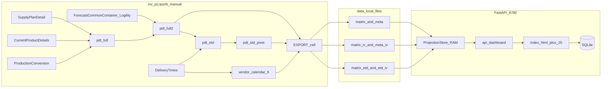

# Architecture — Inventory Projection

Technical design for builders: components, boundaries, runtime paths, and design decisions.

- Business SI rule: [Core logic](Core%20logic.md)
- Sources and scope: [Data](Data.md)
- UI/API contract: [Interface](Interface.md)
- Operate: [Runbook](Runbook.md)

The website does **not** connect to EDW/ODBC; only Jupyter, which you run manually, queries company data.

## 1. Objectives


| Component                     | Function                                                                                 |
| ----------------------------- | ---------------------------------------------------------------------------------------- |
| **Notebook** `inv_prj.ipynb`  | Load EDW → `pdt_full2` (ETA) and `pdt_etd_pivot` (ETD) → EXPORT four website grains      |
| **Website** `app.py` + static | Four matrix tabs (ETA/ETD × Whse/item×vendor), filters, SI Negative Items (local extras) |
| **Cache** `data/`             | Bridge: notebook writes files → FastAPI / Netlify build reads files                      |


**Grain:** `(item, vendor, whse)` × week (`week_end` Saturday) × 16 row variables (11 SI inputs + promo + safety + SI-SS + SS% + SI). ETD grains use the same identity with an ETD week axis.

## 2. Overall architecture




**Data boundaries**


| Source                       | Reader                  | Notes                                      |
| ---------------------------- | ----------------------- | ------------------------------------------ |
| EDW / ODBC                   | Notebook only (manual)  | AI agent must not open the connection      |
| `data/*.csv|parquet`         | FastAPI / Netlify build | Prefer parquet when `pyarrow` is available |
| `inventory_collaboration.db` | FastAPI                 | Notes, import jobs, audit — local only     |


## 3. Directory structure

```text
inv_projection/
├── docs/
│   ├── README.md
│   ├── Core logic.md
│   ├── Data.md
│   ├── Interface.md
│   ├── Runbook.md
│   ├── User guide.md
│   ├── Architecture.md          ← this file
│   └── archive/
├── inv_prj.ipynb
├── export_projection.py         ← SI roll + SS% / SI-SS for ETA and ETD EXPORT
├── app.py
├── START_SERVER.bat
├── DEPLOY_NETLIFY.bat
├── data/
│   ├── inv_projection_matrix.*
│   ├── inv_projection_meta.json
│   ├── inv_projection_matrix_iv.*
│   ├── inv_projection_meta_iv.json
│   ├── inv_projection_matrix_etd.*
│   ├── inv_projection_meta_etd.json
│   ├── inv_projection_matrix_etd_iv.*
│   ├── inv_projection_meta_etd_iv.json
│   └── README.md
├── templates/index.html
├── static/
│   ├── projection-core.js
│   ├── app.js                   ← ETA by Whse
│   ├── iv-app.js                ← ETA
│   ├── etd-app.js               ← ETD by Whse
│   ├── etd-iv-app.js            ← ETD
│   ├── static-projection-api.js ← Netlify client store
│   ├── app.css
│   └── ashley-logo.svg
└── scripts/build_netlify.py
```


## 4. Notebook pipeline (summary)

Canonical source for EXPORT: `pdt_full2` (fallback `pdt_full`). Do not merge `masteritem` / `base_grid` for the website path.

Derived objects of interest:


| DataFrame               | Function                                                                                         |
| ----------------------- | ------------------------------------------------------------------------------------------------ |
| `pdt` / `pdt_full`      | Foundation: ON HAND + Demand/Supply/safety + item profile; Dual Source PO mapped from PSW `dual1` |
| `mb_code` / `pdt_full2` | MB mapped by item/vendor/warehouse; EXPORT source for **ETA** tabs                               |
| `pdt_etd`               | Long view: `pdt_full2` melted to ETA week, Data Types as columns, `ETD = ETA − weekly_lead_time` |
| `pdt_etd_melt`          | Long again by Data type with ETD as the week key                                                 |
| `pdt_etd_pivot`         | Wide like `pdt_full2` but ETD Saturday columns; EXPORT source for **ETD** tabs                   |
| `week_calendar`         | Saturday week-ends; `Wn = -3 .. +45` (ETA EXPORT usually keeps `Wn >= 0`)                        |
| `vendor_calendar_lt`    | Lock Week metadata — not a column in `pdt_full2` / `pdt_etd_pivot`                               |


Full EDW table list and business scope: [Data](Data.md).  
SI formula and variable map (planner **W-1** = notebook **W0**): [Core logic](Core%20logic.md).

EXPORT calls `export_projection()` twice (then SS% / SI-SS): `pdt_full2` → ETA Whse + ETA item×vendor (**ON HAND** roll from W-1); `pdt_etd_pivot` → ETD Whse + ETD item×vendor (**clip from ETA W-1**; SHIPPABLE INV on W-1/W1; roll from W2). Lock Week dates are written only in **ETA** Whse meta. The website **Risk Item** filter on ETD reuses that calendar against ETD SI (no Lock Week cell styling on ETD). Scale counts live in `data/inv_projection_meta.json`.

## 5. Website backend (`app.py`)


### Stack

- FastAPI + Jinja2 + StaticFiles
- Host: `127.0.0.1:8780` (`START_SERVER.bat`)
- SQLite: notes / imports / audit
- Pandas + NumPy: load matrix into `ProjectionStore`


### ProjectionStore

1. Read parquet or CSV once.
2. Store route metadata plus an `int32` array `(n_routes, n_weeks)` per variable.
3. Cache by latest `mtime` of matrix + meta; `POST /api/refresh` clears the cache.
4. `query(filters, limit)` → fast slice; default **limit = 100**.

Do not convert all large route sets with a `groupby` loop for ordinary requests. Controlled exception: **ETA** / **ETD** (item×vendor) with an MB or Risk Item filter re-aggregates matching warehouses and re-rolls SI (**ETA** from ON HAND-backed opening; **ETD** keeps W-1/W1 SHIPPABLE copies then rolls from W2).

Exceptions are **not** computed server-side; the browser builds them from `rows` so they reflect Data Type toggles and exclusions.

### Sample vs 503


| Condition                          | Behavior                                                           |
| ---------------------------------- | ------------------------------------------------------------------ |
| No export files in `data/`         | Embedded sample rows; `freshness.source = Sample data`             |
| Files present but read/query fails | HTTP **503** with `detail` — never replace real export with sample |


API surface and response fields: [Interface](Interface.md).

SI Negative Items are served by `GET /api/risk-items`. The endpoint classifies every matching warehouse route against baseline `inv_projection` and `lock_weeks_by_warehouse` before applying the display limit, then deduplicates to Item × Vendor for the item-level view.

## 6. Frontend


| File                        | Role                                               |
| --------------------------- | -------------------------------------------------- |
| `templates/index.html`      | Shell                                              |
| `static/projection-core.js` | Exclusion store, SI recalc, shared filter bus, CSV |
| `static/app.js`             | **ETA by Whse**                                    |
| `static/iv-app.js`          | **ETA** (lazy init when tab opens)                 |
| `static/etd-app.js`         | **ETD by Whse**                                    |
| `static/etd-iv-app.js`      | **ETD**                                            |
| `static/app.css`            | Light/dark (one `:root[data-theme="dark"]` block)  |


Asset cache busting: `app.py` passes `asset_version` (latest `mtime` in `static/`) → `?v=…`.

Client SI / exclusion / Lock Week contract: [Interface](Interface.md) and [Core logic](Core%20logic.md).

### Netlify static snapshot

Laptop runs EXPORT + build; Netlify hosts static files. Do **not** tunnel `127.0.0.1`.

Pipeline: `data/*.parquet` → `scripts/build_netlify.py` → `netlify_dist/` (routes JSON + gzip int32 + static; `static-projection-api.js` emulates `/api/dashboard`) → `DEPLOY_NETLIFY.bat`.

`netlify.toml`: `publish = netlify_dist`, cloud build ignored (deploy from PC). Operator steps: [Runbook](Runbook.md).

## 7. Design decisions

1. Notebook builds PDT frames; website EXPORT SI roll lives in `export_projection.py` (called twice: ETA + ETD).
2. Date columns come from `week_calendar` (Saturday).
3. Demand vendor = `Primary Vendor`.
4. Only `inv_projection` is rolled; promotional lift, safety stock, SI-SS, and SS% are display-only.
5. Website does **not** live-query EDW.
6. API always uses limits + server-side filters; does not serialize the full matrix to the browser.
7. Client calculates exception list and adjusted SI; server returns raw `rows`.
8. Missing export → sample demo; failed read of existing export → **503** (no silent sample swap).
9. Shared filter state uses `ProjectionFilterSync`; item×week exclusions remain session-local per tab.
10. Netlify is a static daily snapshot; no FastAPI on the CDN and no localhost tunnel.
11. MB filter uses `pdt_full2` / `pdt_etd_pivot`; on **ETA** / **ETD**, MB or Risk Item scope re-aggregates warehouses and re-rolls SI.
12. Warehouse codes preserved (`335` ≠ `CNW`).


## 8. Out of scope / incomplete

- PlanTrsIn / transit shift (DeliveryTimes currently Lock Week only — not yet a `pdt_full2` column)
- Separate Python module for projection math
- AI agent execution of EDW/ODBC or production schedulers
- Mandatory parquet (CSV remains sufficient; `pyarrow` speeds parquet)
- Live Netlify ↔ local FastAPI tunnel


## 9. Quick links


| Document                              | Contents                                                                            |
| ------------------------------------- | ----------------------------------------------------------------------------------- |
| [README](README.md)                   | Product hub                                                                         |
| [Core logic](Core%20logic.md)         | SI formula / variables                                                              |
| [Data](Data.md)                       | EDW sources / scope                                                                 |
| [Interface](Interface.md)             | UI / API contract                                                                   |
| [Runbook](Runbook.md)                 | Operate / deploy / recover                                                          |
| [User guide](User%20guide.md)         | Planner tasks                                                                       |
| `[data/README.md](../data/README.md)` | Cache file list                                                                     |
| Archive                               | `[archive/2026-08-doc-consolidation/](archive/2026-08-doc-consolidation/README.md)` |


