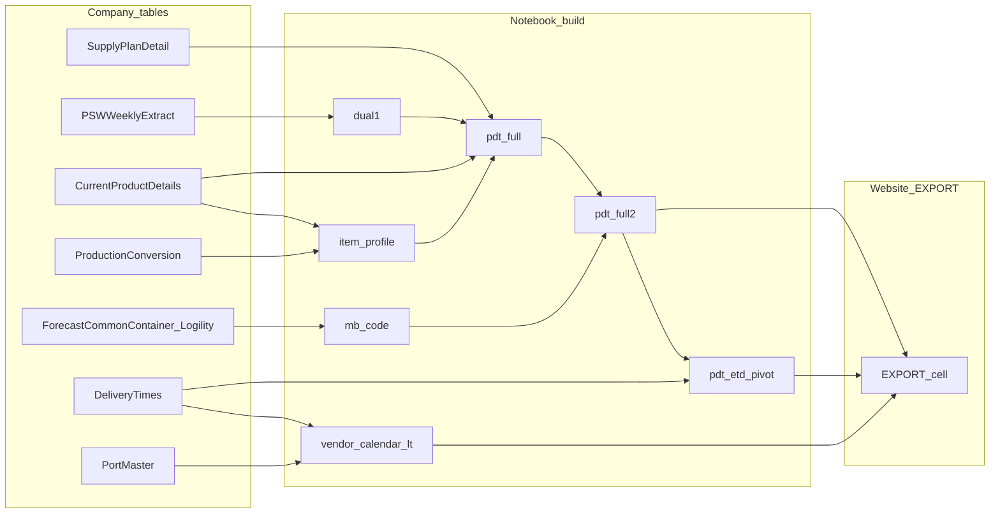

---
type: product-doc
product: inv-projection
summary: "Where Inventory Projection numbers come from — company tables, scope, and caveats"
modified: 2026-09-16
---

# Data — Inventory Projection

This page answers one question for business users:

**Where do the numbers on the Inventory Projection website come from?**

It lists the company database tables used, what each table contributes, and what is *not* used for the live projection view. SI rules live in [Core logic](Core%20logic.md).

## 1. In plain terms

1. An analyst refreshes data from company systems in a notebook.
2. That refresh builds **`pdt_full2`** (ETA weeks) and, from it, **`pdt_etd_pivot`** (ETD weeks = ETA minus vendor×warehouse lead time).
3. The website shows four views of the **same** snapshot:
  - **ETA by Whse** — item × vendor × warehouse (ETA weeks)
  - **ETA** — item × vendor (warehouses combined)
  - **ETD by Whse** — item × vendor × warehouse (ETD weeks)
  - **ETD** — item × vendor (warehouses combined, ETD weeks)

The website does **not** connect live to company databases. It only shows the last exported snapshot (local site or Netlify publish).

## 2. Source data

| Company table                                          | Function                                                             | Used for this project?                                    |
| ------------------------------------------------------ | -------------------------------------------------------------------- | --------------------------------------------------------- |
| `[Wholesale_DemandPlanning_AFI].[SupplyPlanDetail]`    | Weekly plan: on hand, demand, supply, safety stock, promotional lift | **Yes** — main variables                                  |
| `[SupplyChain_Enh].[PSWWeeklyExtractSnapshot]`         | Weekly PSW planned/firm PO by item, warehouse, vendor                | **Yes** — Dual Source display rows (secondary vendor only) |
| `[PowerBI_SupplyChain].[CurrentProductDetails]`        | Item master: series, division, vendor, status, hold/buy              | **Yes** — item information                                |
| `SupplyChain_Enh.ProductionConversion`                 | Production / resource assignment for the item                        | **Yes** — Production Resources filter                     |
| `[SupplyChain_Enh].[ForecastCommonContainer_Logility]` | Make / Buy (MB) code from planning                                   | **Yes** — MB code change filter                           |
| `[Enterprise_DW].[DimDate]`                            | Calendar (helps pick the correct MB file date)                       | Supporting only                                           |
| `[PowerBI_SupplyChain].[VendorMaster]`                 | Vendor name and office                                               | Supporting only                                           |
| `[Wholesale_ProductSourcing_AFI].[DeliveryTimes]`      | Transit time / lead time by warehouse and port                       | Lock Week calendar **and** ETA → ETD (`pdt_etd`) |
| `[Wholesale_ProductSourcing].[PortMaster]`             | Port / city names (linked to Delivery Times)                         | Used with DeliveryTimes (Lock Week + ETD convert) |
| `[Inventory_Enh_History].[ItemBalance]`                | Historical on-hand balances                                          | **For reference only**                                    |
| `[Wholesale_ProductSourcing_AFI].[PoMaster]`           | Purchase order header (ETD / ETA / Due)                              | **For reference only**                                    |

### Working dataset lineage

- **ETA path:** SupplyPlanDetail + item profile → `pdt_full` → merge MB (Logility) → **`pdt_full2`** → EXPORT (`inv_projection_matrix*` / `_iv*`). Dual-source PSW (`dual1`) maps onto PDT by item × warehouse × Due Date (ETA Saturday) as display-only Planned/Firm PO + secondary vendor name. DualSource = Yes when PSW Vendor is the secondary vendor (`Vendor` joined to ProductionConversion `LocationID`).
- **ETD path (notebook dataframes):** `pdt_full2` → `pdt_etd` (ETD = ETA − weekly lead time) → `pdt_etd_melt` → **`pdt_etd_pivot`** (wide, ETD Saturdays) → EXPORT (`inv_projection_matrix_etd*` / `_etd_iv*`). Dual Source rows ride along as display-only Data Types; they still do not enter SI.
- **Lock Week path:** DeliveryTimes + PortMaster → `vendor_calendar_lt` → ETA Whse meta only (not a column in `pdt_full2` / `pdt_etd_pivot`). ETD Risk Item on the website still uses that calendar against ETD SI.
- EXPORT prefers **`pdt_full2`** (and **`pdt_etd_pivot`** for ETD) and falls back to **`pdt_full`** only when `pdt_full2` is unavailable. Do not merge `masteritem` / `base_grid` for the website path.
- Key normalization on EXPORT: `item` / `vendor` / `whse` / `mb` as stripped strings; warehouse codes preserved (`335` ≠ `CNW`).

## 3. Business scope (what is included)

| Dimension                 | Current scope                                                             |
| ------------------------- | ------------------------------------------------------------------------- |
| Items                     | Items under the vendors below (not all Ashley items)                      |
| Vendors                   | `600039`, `900515`, `900639`, `624556`                                    |
| Warehouses                | `1`, `5`, `15`, `17`, `28`, `335`, `ECR`                                  |
| Week columns on the site  | Saturday week-ending dates from the plan snapshot. From Week -1 until EOT |
| Lock Week markers         | ETA by Whse styling only. Same warehouse calendar is used to classify **Risk Item** on ETD SI. |
| Notebook week horizon     | About `Wn = -3 … +45` around the snapshot                                 |
| Website default view      | Opening week **W-1** and forward (**W1**, **W2**, …). ETA clips `Wn >= 0`; ETD clips from the same W-1 Saturday as ETA. |
| Demand / Supply variables | See [Core logic](Core%20logic.md)                                         |
| Snapshot                  | Latest available plan date from Supply Plan Detail                        |
| MB snapshot               | Latest Monday file date from Logility                                     |
| Refresh cadence           | Daily (manual notebook export + optional Netlify publish)                 |

**Note:** Warehouse codes are kept as-is. `335` and `CNW` are treated as **different** locations.

Scale (route count, weeks, rows) is snapshot-specific — see `data/inv_projection_meta.json` after each EXPORT, not hard-coded here.

## 4. What each website view represents

| Website tab         | One row means                           | Typical use             |
| ------------------- | --------------------------------------- | ----------------------- |
| **ETA by Whse**     | One item × vendor × warehouse           | Detail by location      |
| **ETA**             | One item × vendor (warehouses combined) | Portfolio / vendor view |
| **ETD by Whse**     | Same identity as ETA by Whse; week = ETD Saturday from `pdt_etd_pivot` | Detail by location on ship week |
| **ETD**             | Same identity as ETA; ETD week axis                            | Portfolio / vendor view on ship week |

Both ETA and ETD come from the **same** notebook refresh. ETD weeks are ETA Saturdays shifted by vendor×warehouse lead time (`pdt_etd`), then **clipped from W-1** for the website. The item×vendor tabs sum warehouses and recalculate projected inventory (ETA vs ETD rules in [Core logic](Core%20logic.md)).

Cache files: see [data/README.md](../data/README.md).

## 5. What users should know

- **Projected inventory (SI)** — ETA: opening on hand + supply − demand each week. ETD: SHIPPABLE INV on W-1 and W1, then roll from W2 ([Core logic](Core%20logic.md)).
- **Promotional lift**, **safety stock**, and **Dual Source Planned/Firm PO** are shown for reference. They are **not** in the website SI formula. Dual Source is the secondary vendor’s PSW planned/firm qty on dual-source items; primary Planned POs / Firm POs still drive Supply. (If planning already embeds promo inside Firm Demand upstream, that is already in Firm Demand — the separate Promo Lift row is display-only here.)
- **Firm Production** and **Planned Production** are supply inputs in SI.
- **MB** comes from the Logility Make/Buy table, not from Supply Plan Detail alone.
- **Lock Week** markers come from transit / lead-time logic. They highlight weeks on **ETA by Whse** only; they do not rewrite demand or supply. ETD tabs do not underline lock weeks.
- Notebook **§3 / §4** compare rolled website SI to PDT `SHIPPABLE INV` on both ETA and ETD (`data/si_compare_gap*.csv`). That check is not on the website.
- If the website says **Sample data**, no export files are present yet (demo rows only).
- Turning Data Types on/off in the UI only changes the current session view. It does **not** change company source data until the next notebook refresh and export.

## 6. Related documents

- Business rules / SI formula: [Core logic](Core%20logic.md)
- How to use the site: [User guide](User%20guide.md)
- How to refresh and publish: [Runbook](Runbook.md)
- Technical components: [Architecture](Architecture.md)

